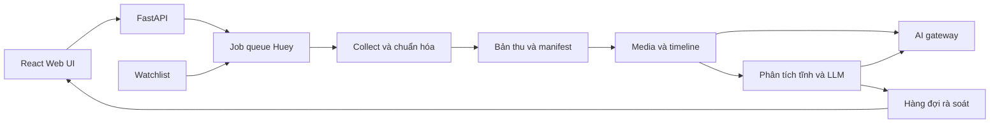

# h4wk — Công cụ hỗ trợ rà soát nội dung YouTube

**Báo cáo môn học — bản nháp, chưa duyệt.** Mốc mã nguồn đối chiếu: `6f3bbe2`. Mục tiêu trình diễn, kết quả thử nghiệm và số liệu còn thiếu được trình bày riêng.

## Mục lục

1. Mục tiêu và phạm vi
2. Kiến trúc và luồng xử lý
3. Bảo toàn và truy vết bằng chứng
4. Thu thập đa nguồn
5. Phát hiện và rà soát nghi vấn
6. Khớp khuôn mặt có giới hạn
7. Kết quả và phương pháp đo
8. Giới hạn và việc còn lại

## 1. Mục tiêu và phạm vi

h4wk hỗ trợ analyst rà soát nội dung có khả năng bôi nhọ một đối tượng đã khai báo trên YouTube. Đầu vào không chỉ là văn bản: lời nói, chữ trong ảnh, hình ảnh, thumbnail và bình luận có thể đóng góp bằng chứng khác nhau. Đầu ra là **nghi vấn có căn cứ để mở lại nguồn**, không phải kết luận pháp lý hay phán quyết về người đăng. Dấu hiệu cho biết đối tượng có thể xuất hiện; nghi vấn cho biết nội dung cần xem xét. Hai khái niệm không đồng nhất ([SPEC §1–2](<../../SPEC.md#L7-L46>)).

| Màn | Câu hỏi cần trả lời | Kịch bản theo đặc tả, không phải kết quả đo |
|---|---|---|
| 1. Dữ liệu chuẩn bị sẵn | Analyst có thể kiểm tra căn cứ của một nghi vấn không? | Từ hàng đợi mở đúng đoạn video, transcript và khung ảnh. Bộ demo hướng tới ít nhất 10 video thật, có nghi vấn lời nói, OCR và hình ảnh, kể cả một đoạn không nhắc tên. |
| 2. Dán liên kết | Có thể theo dõi video từ lúc gửi yêu cầu đến lúc có kết quả không? | Hiển thị các bước thu thập, chuyển lời nói, trích khung, OCR/VLM, khớp và phân tích. Mục tiêu khoảng 5 phút cho video dài không quá 5 phút. |
| 3. Watchlist | Hệ thống phát hiện và tự xử lý video mới trên kênh đã theo dõi không? | Sự kiện mới hiện trên dashboard. Không buộc sinh nghi vấn mới. Mục tiêu khoảng 10 phút **sau khi phát hiện**, không tính từ thời điểm đăng. |

Nguồn: [SPEC §8](<../../SPEC.md#L165-L197>). Phiên bản này chỉ thực hiện kịch bản K1. Phân tích mạng lưới kênh, lập hồ sơ người bình luận, theo dõi theo từ khóa, lưu WARC và tìm kiếm ngữ nghĩa không thuộc phạm vi; báo cáo môn học này cũng không phải tính năng xuất báo cáo trong ứng dụng ([SPEC §11–12](<../../SPEC.md#L523-L564>)).

## 2. Kiến trúc và luồng xử lý

Backend Python dùng FastAPI cho API, SQLite/SQLModel cho chỉ mục và Huey cho việc nền; web dùng React và TypeScript. `ffmpeg` xử lý phương tiện, OCR đọc chữ trong ảnh, VLM mô tả khung. Phân chia module cho phép xem lại kết quả cũ mà không phải tải lại video hoặc gọi lại mô hình mỗi lần mở giao diện ([SPEC §2–3](<../../SPEC.md#L15-L68>)).

Các hợp đồng làm rõ ranh giới giữa giai đoạn: C1 mô tả bản thu và manifest; C2 chuẩn hóa đầu vào về một cấu trúc chung; C3 nối transcript, OCR và hình ảnh vào timeline; C4 mô tả dấu hiệu, nghi vấn và quyết định; C5 mô tả cấu hình. Ví dụ, bước phân tích lấy vị trí đoạn từ C3 chứ không dựa vào cấu trúc phản hồi riêng của YouTube hoặc yt-dlp ([SPEC §2, §10](<../../SPEC.md#L211>)).

Job có thể do người dùng khởi tạo hoặc do watchlist phát hiện video mới. Mức thu `metadata`, `text` và `full` quyết định phần dữ liệu và bước xử lý cần chạy. Thiếu media không đồng nghĩa thiếu toàn bộ dữ liệu: khi vẫn còn đầu vào văn bản, hệ thống có thể phân tích phần đó. Giao diện cần phân biệt bước chưa chạy, đang chạy và lỗi để analyst biết việc thiếu nghi vấn là do chưa xử lý hay do đã xử lý nhưng chưa có kết quả ([SPEC §8, §10.7, §10.9](<../../SPEC.md#L451-L506>); [pipeline.py](<../../backend/src/h4wk/jobs/pipeline.py>)).

## 3. Bảo toàn và truy vết bằng chứng

Bản thu được định danh bằng ID video và thời điểm `YYYYMMDDTHHMMSS` theo giờ Việt Nam (`UTC+07:00`). Thư mục bản thu chứa dữ liệu thô theo từng nguồn, bản chuẩn hóa và manifest. Dữ liệu phái sinh như video proxy, ảnh khung, transcript, timeline và nghi vấn nằm ngoài bản thu gốc; phân tích lại không sửa dữ liệu thô. Thu lại tạo thư mục mới và liên kết `previous_capture` về bản trước, giúp phân biệt khi nguồn thay đổi với khi thuật toán thay đổi ([SPEC §10.2](<../../SPEC.md#L231-L285>)).

Manifest ghi URL, thời điểm, tác nhân, loại kích hoạt, mức thu, phiên bản công cụ, kết quả từng nguồn, cùng kích thước và SHA-256 của mỗi tệp. Theo thiết kế, bản thu được ghi vào thư mục tạm cùng ổ đĩa; manifest ghi cuối rồi chuyển thư mục sang vị trí chính thức và đặt chỉ đọc. Các trạng thái như `blocked`, `disabled`, `suspended` và `no_source` giải thích vì sao một nhóm dữ liệu thiếu, thay vì để người đọc suy đoán dữ liệu chưa từng tồn tại ([SPEC §10.2](<../../SPEC.md#L254-L285>); [evidence](<../../backend/src/h4wk/evidence/>)).

`h4wk verify <capture-dir>` kiểm lại trạng thái `OK`, `FAIL`, `missing`, `unexpected` theo manifest. Ví dụ, tệp còn đúng tên nhưng bị sửa một byte sẽ khác giá trị băm; tệp bị xóa được phân biệt với tệp sửa. Cơ chế này kiểm tính nhất quán với manifest, không chứng minh nội dung YouTube là thật và không chống được người cố ý thay cả dữ liệu lẫn manifest. Quyền chỉ đọc chủ yếu tránh sửa nhầm ([SPEC §8 và §10.2](<../../SPEC.md#L277-L285>); [test_fixtures.py](<../../backend/tests/unit/test_fixtures.py>)).

## 4. Thu thập đa nguồn

Ba nguồn nằm trong phạm vi là yt-dlp, YouTube API và Supadata. Mỗi loại dữ liệu có thứ tự nguồn riêng: khả năng thu video, phụ đề, metadata và bình luận không giống nhau. Hệ thống chọn một nguồn thành công cho mỗi loại, không trộn những trường đo từ các nguồn khác nhau để tạo một bản ghi có vẻ đầy đủ hơn. C2 giữ provenance ở mức lần gọi nguồn, đủ giải thích dữ liệu đến từ đâu nhưng chưa giải quyết mâu thuẫn ở từng trường ([SPEC §10.3, §12](<../../SPEC.md#L287-L312>); [collectors](<../../backend/src/h4wk/collectors/>)).

Theo đặc tả, lỗi tạm thời được thử lại có giới hạn; lỗi bị chặn hoặc hết quota chuyển nguồn ngay. Nguồn lỗi năm lần liên tiếp có thể bị tạm ngưng 30 phút. Nếu tắt yt-dlp, metadata và bình luận vẫn có thể lấy qua YouTube API; không có nguồn tải media phù hợp thì manifest ghi `no_source` và pipeline không tạo bằng chứng hình từ thứ không thu được. Nhấn **Check now** trong kịch bản watchlist dùng đường kiểm tra chủ động thay vì phụ thuộc thời điểm làm mới RSS ([SPEC §8, §10.3](<../../SPEC.md#L191-L197>); [spike yt-dlp/RSS](<../spikes/ytdlp-rss.md>)).

Phụ đề được phân biệt theo nguồn gốc: `uploaded`, `auto`, `supadata_ai`, `stt`. Analysis dùng một transcript chính, không gộp nhiều bản như thể độc lập. Phụ đề thu từ nguồn theo phạm vi tiếng Việt và không yêu cầu bản dịch máy; đây là quyết định phạm vi và quota chứ không phải phương pháp đánh giá chất lượng bản dịch ([SPEC §10.3, §13](<../../SPEC.md#L570-L576>)).

## 5. Phát hiện và rà soát nghi vấn

**Tìm dấu hiệu.** Tên, biệt danh và viết tắt được đối chiếu trong văn bản; khóa so khớp chuẩn hóa chữ, dấu và ranh giới từ. Hai nguồn tín hiệu khác là ảnh mẫu dùng lại và khuôn mặt mẫu. Các dấu hiệu giúp thu hẹp đoạn cần xem; tên trùng hoặc ảnh khớp chưa đủ để nói đoạn đó mang nội dung bôi nhọ ([SPEC §10.6](<../../SPEC.md#L379-L397>)).

**Tầng tĩnh.** Khớp tên chỉ tạo dấu hiệu. Quy tắc tĩnh tạo nghi vấn khi cụm từ trong từ điển khớp trong vùng văn bản có dấu hiệu tên; kết quả ghi loại và lý do ([SPEC §10.6](<../../SPEC.md#L391>)). Quy tắc này chạy không cần nhà cung cấp AI. Ít phụ thuộc hạ tầng bên ngoài nhưng không tự giải nghĩa được mỉa mai, hàm ý hình ảnh hoặc ngữ cảnh trích dẫn. Vì vậy cần giữ căn cứ để người rà soát phân biệt một câu tường thuật lại lời cáo buộc với lời cáo buộc của chính người nói ([SPEC §10.6](<../../SPEC.md#L379-L450>)).

**Tầng LLM.** `analysis.classify` nhận đoạn đã có dấu hiệu kèm đoạn liền trước và liền sau. Trong video liên quan, đoạn có dấu hiệu hình ảnh (`offensive_cues`) vẫn được xét dù không nhắc tên. Tiêu đề, mô tả và thumbnail cũng có thể là đầu vào; comment có đường phân loại riêng. Prompt yêu cầu đánh giá lời nói, OCR và hình riêng, nêu căn cứ quan sát được, không đoán danh tính người trong hình. Từ nặng một mình không đủ để kết luận; cần phân biệt phê bình có lập luận với công kích cá nhân hoặc cáo buộc thiếu căn cứ ([llm.py](<../../backend/src/h4wk/analysis/llm.py>); [classify.md](<../../backend/src/h4wk/analysis/prompts/classify.md>)).

Đầu ra AI phải qua kiểm tra cấu trúc. Kết luận trung tính hoặc phê bình hợp lý không được đưa vào hàng đợi như nghi vấn; lỗi tuyến AI không biến bản thu thành thất bại toàn phần, vì nghi vấn tĩnh còn sử dụng được. Cần phân biệt “tầng LLM không tìm thấy” với “tầng LLM không trả được kết quả” khi đọc nhật ký hoặc so sánh hai tầng ([runner.py](<../../backend/src/h4wk/analysis/runner.py>); [T23](<../../tasks/todo.md#L483-L504>)).

**Rà soát của người.** Analyst mở nghi vấn, kiểm lời nói hoặc khung hình ở ngữ cảnh gốc, rồi chọn Confirm, Reject hoặc Needs info. Reject cần lý do; quyết định có người thực hiện và thời điểm. Không có bước tự Confirm. Phân tích lại tạo nghi vấn của lần chạy mới, không tự mang quyết định cũ sang ([SPEC §8, §10.8, §13](<../../SPEC.md#L478-L492>)).

## 6. Khớp khuôn mặt có giới hạn

Đặc tả thay đổi quy định “không nhận diện khuôn mặt” trong mô tả gốc vì một đoạn có thể ám chỉ đối tượng bằng hình mà không nhắc tên. Mục tiêu là bổ sung **dấu hiệu so khớp với đối tượng đã khai báo** để analyst xem lại đoạn, không phải xác định một người lạ là ai. So khớp ảnh mẫu dùng lại và ngữ cảnh toàn video cũng là đường phát hiện khác; một nghi vấn hình ảnh không nhất thiết đến từ so khớp mặt ([SPEC §8, §10.6, §13](<../../SPEC.md#L581>)).

Phạm vi bắt buộc: chỉ so với ảnh mẫu của đối tượng đã khai báo; không xác định danh tính người khác; không lưu đặc trưng của khuôn mặt không khớp. Bước khớp chạy trên máy và có thể tắt; không gửi ảnh mặt mẫu cho nhà cung cấp AI. Giới hạn đó không đồng nghĩa mọi khung nội dung đều chỉ xử lý tại chỗ: VLM và LLM là các tác vụ khác có tuyến AI riêng. Bước này dùng OpenCV YuNet để phát hiện và SFace để so khớp trên CPU, với ngưỡng cosine 0,363; chất lượng trên ảnh thành viên chưa được nghiệm thu ([SPEC §3, §10.5–10.6, §11](<../../SPEC.md#L540-L548>); [T41 và T44](<../../tasks/todo.md>)).

Theo cách áp dụng tại SPEC §13, dữ liệu khuôn mặt là dữ liệu cá nhân nhạy cảm theo Nghị định 13/2023; bản demo dùng chính khuôn mặt thành viên nhóm làm mẫu. Lựa chọn dữ liệu demo và ranh giới về đối tượng, lưu trữ, xử lý tại chỗ nhằm hạn chế rủi ro; chúng không tự chứng minh dự án đáp ứng mọi nghĩa vụ pháp lý. **[cần bổ sung: đối chiếu điều khoản áp dụng của Nghị định 13/2023 và cách ghi nhận sự đồng ý, lưu giữ và xóa dữ liệu demo trước khi nộp bản cuối.]**

## 7. Kết quả và phương pháp đo

| Hạng mục | Phép đo hoặc điều kiện | Kết quả |
|---|---|---|
| Màn 2 | Từ lúc gửi liên kết đến khi xử lý xong; ghi độ dài video và mức thu | [chờ T37] |
| Màn 3 | Từ khi phát hiện video mới đến khi xử lý xong; ghi thời điểm đăng riêng | [chờ T37] |
| Tầng tĩnh | Precision và recall trên tập gán nhãn chung | [chờ T38] |
| Tầng LLM | Precision và recall trên cùng tập; báo riêng ca không có phản hồi AI | [chờ T38] |

Mỗi lần đo cần ghi mốc mã nguồn, máy, cấu hình, trạng thái cache và lỗi nguồn. Precision là tỷ lệ dự đoán dương đúng trên tổng dự đoán dương; recall là tỷ lệ mẫu dương được tìm thấy trên tổng mẫu dương theo nhãn tay. Không lấy nghi vấn do chính hệ thống sinh làm nhãn chuẩn. Thống nhất đơn vị gán nhãn trước khi so sánh; không biến một lần đo demo thành ước lượng đại diện cho toàn YouTube ([T37–T38](<../../tasks/todo.md#L794-L818>)).

**Kết quả đã có:**

- Spike GPU dùng RTX 3050 Laptop 4 GB. Whisper large-v3 nạp trong 6,77 giây; hai lượt trên cùng worker mất 7,07 giây và 1,70 giây. VAD loại toàn bộ khoảng 40 giây âm thanh thử; đây **không phải** tốc độ giải mã lời nói hay thời gian màn 2 ([gpu-models.md](<../spikes/gpu-models.md#L5-L13>)).
- Spike RSS ghi một mẫu video xuất hiện sau 599 giây; header có `max-age=900`. Một mẫu không đủ để suy ra trung bình hoặc phân vị. Số này đo phát hiện qua RSS, không đo thời gian xử lý sau khi phát hiện ([ytdlp-rss.md](<../spikes/ytdlp-rss.md#L55-L77>)).
- Mốc `6f3bbe2` được báo cáo 446 test pass, 3 skip và 27 deselected trong bộ mặc định. Nguồn số liệu: báo cáo kiểm thử sau merge của lead ngày 20/11/2026 (Thread T23 `thread:08d1b3c7-9ddc-48f4-b1af-4b56e395f8f1`, thông báo `message:fa9f811e-6a19-41f2-a9dc-1036e0db223f`); số deselected từ lần chạy bộ mặc định của backend trên nhánh T23 trước rebase (`38921c7`). Lệnh tái kiểm là `uv run --no-sync pytest` trong backend; mặc định loại test live. Kết quả kiểm thử phần mềm không phải độ chính xác mô hình ([pyproject.toml](<../../backend/pyproject.toml#L81-L87>)).

## 8. Giới hạn và việc còn lại

- **Quota AI.** Trong lần chạy nghiệm thu ngày 20/11/2026, Gemini trả HTTP 429 với quota free tier 20 yêu cầu/ngày theo dự án và model trên cấu hình thử; OpenRouter miễn phí cũng hết hạn mức ngày. Nguồn số liệu: chẩn đoán gọi trực tiếp từng nhà cung cấp trong Thread T21 (`thread:0a513a73-47f8-4aed-a580-093ceb94fec7`), báo cáo `message:532b6582-5e78-4458-a333-97eb24ebc781`. Đây là quan sát của lần chạy, không phải hạn mức mặc định cho mọi tài khoản. Cần báo lỗi nguồn và số lượt hợp lệ khi trình bày kết quả; không đánh đồng lỗi API với chất lượng prompt. Cơ chế chuyển tuyến và giữ kết quả tĩnh được mô tả ở [SPEC §10.4](<../../SPEC.md#L314-L332>) và [runner.py](<../../backend/src/h4wk/analysis/runner.py>).
- **Độ đại diện dữ liệu.** Bản thu mẫu dùng hình vẽ, phụ đề tự tạo và tiếng bíp, thích hợp cho kiểm thử hợp đồng và luồng dữ liệu nhưng không đo được chất lượng STT trên lời thật hay chất lượng khớp mặt thành viên. Video thật chờ T44; không lấy minh chứng trên mẫu tổng hợp thay cho nghiệm thu T18 hoặc T41 ([script dựng mẫu](<../../backend/tests/fixtures/build_sample_capture.py#L1-L9>); [tasks/todo.md](<../../tasks/todo.md>)).
- **Phạm vi AI và pháp lý.** Nghi vấn có thể sai do OCR, phụ đề, mô tả hình, nhập nhằng đối tượng hoặc ngữ cảnh không đầy đủ. Nhật ký, đoạn trích và thao tác rà soát giúp phát hiện lỗi; chúng không bảo đảm tính đúng đắn pháp lý của phân loại. Không dùng kết quả để nhận diện người ngoài đối tượng đã khai báo ([SPEC §10.6 và §11](<../../SPEC.md#L379-L397>)).
- **Việc còn lại.** [chờ T37] đo trên máy demo; [chờ T38] nhãn tay và bảng so sánh; [chờ T44] video thật. [cần bổ sung: đối chiếu danh sách “Nên sửa” còn mở tại thời điểm chốt báo cáo.] Hồ sơ nghiệm thu báo cáo chỉ hoàn tất sau khi hai thành viên đọc và duyệt bản cuối ([T43](<../../tasks/todo.md#L819-L829>)).
