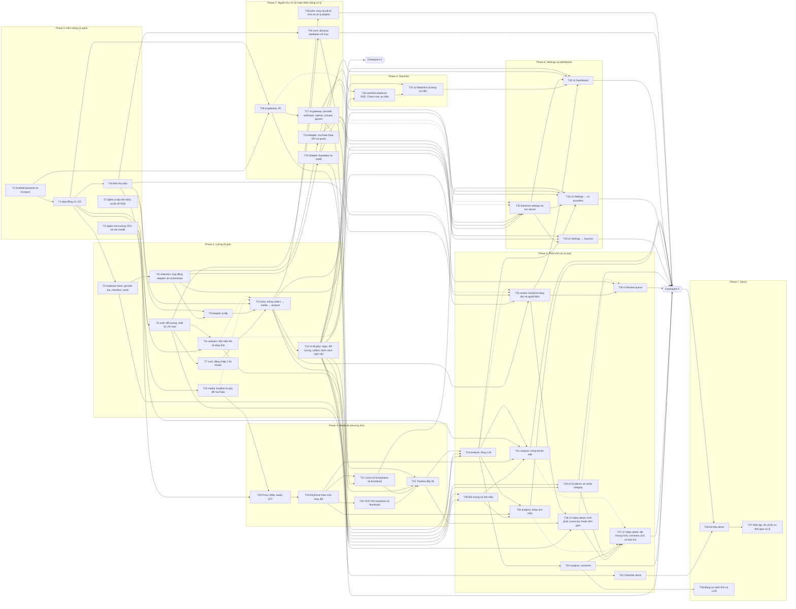

# Kế hoạch triển khai: h4wk V1 (bản demo)

Spec: [SPEC.md](../SPEC.md)
Danh sách task chi tiết: [tasks/todo.md](todo.md)
Trạng thái: đã duyệt ngày 2026-11-18, chưa bắt đầu triển khai

## Tổng quan

Kế hoạch nhắm tới một luồng K1 đa phương thức chạy trọn từ đầu đến cuối, phục vụ 3 màn demo:

1. Dữ liệu chuẩn bị sẵn và rà soát nghi vấn, có nghi vấn từ lời nói, chữ trên hình và hình ảnh.
2. Dán link và xử lý ngay tại chỗ.
3. Watchlist tự phát hiện video mới.

Tuần 1 dựng một luồng tối giản: dán link → yt-dlp → bản thu → transcript → khớp tĩnh → nghi vấn trên giao diện. Sau đó từng module được làm sâu dần theo các lát dọc. Năm hợp đồng C1–C5 được Thi viết ở T4, bản thu mẫu dựng ở T44, và hợp đồng được chốt tại checkpoint A.

Thi là người chịu trách nhiệm chính. Kế hoạch (cách chia ban đầu) được sắp để task của Thi không phải chờ task của Bảo: chỗ nào Thi cần phần của Bảo thì Thi làm trước với bản thu mẫu của T44, và nối vào khi phần của Bảo xong.

## Quyết định kiến trúc

- Hợp đồng C1–C5 được viết trước, dưới dạng mô hình Pydantic. Từ các mô hình này sinh ra JSON Schema để test validate, và sinh ra kiểu TypeScript cho frontend qua OpenAPI. Sau checkpoint A, mọi thay đổi hợp đồng phải được Thi đồng ý.
- Dữ liệu chuẩn nằm trong file; SQLite chỉ làm chỉ mục. Lệnh `h4wk reindex` có từ phase 2 (T45). Tài khoản, watchlist và lịch sử job chỉ nằm trong database, nên reindex làm mất các dữ liệu này; nhóm chấp nhận hạn chế đó trong giai đoạn thử nghiệm.
- Luồng thu → xử lý → phân tích chạy nền qua Huey ngay từ phase 1, vì màn 2 và màn 3 đều cần hiện tiến độ và chạy nền. Các bước dùng GPU chạy trên một hàng đợi riêng với 1 worker, model được nạp một lần cho mỗi worker.
- Mỗi bước của media-pipeline idempotent theo `derived/<capture>/`: bước nào đã có output hợp lệ thì được bỏ qua. Khi worker khởi động lại, job đang dở được đưa lại vào hàng đợi và chạy tiếp từ chỗ dở dang.
- `media-pipeline` không biết đối tượng là ai. Mọi việc liên quan tới đối tượng (khớp tên, khớp khuôn mặt, khớp ảnh mẫu) nằm trong `analysis`. Nhờ vậy, đổi ảnh mẫu của đối tượng không buộc phải xử lý lại media.
- Khớp khuôn mặt và khớp ảnh mẫu chỉ sinh dấu hiệu. Dấu hiệu kéo đoạn video vào tầng LLM, nhưng tự nó không phải nghi vấn.
- Test không gọi mạng. Adapter thu thập được test bằng raw response đã ghi sẵn, tầng AI được test bằng `FakeProvider`. Lời gọi thật chỉ chạy trong `pytest -m live`.
- Giao diện React dùng kiểu sinh từ OpenAPI, để người làm frontend không phải viết tay kiểu dữ liệu cho API.

## Đồ thị phụ thuộc

Đồ thị được sinh tự động từ mục "Phụ thuộc" và "Tích hợp sau" của từng task trong [todo.md](todo.md). Mũi tên liền `A --> B` nghĩa là A phải xong trước B. Mũi tên chấm `A -.-> B` nghĩa là B làm trước được với dữ liệu mẫu và nối vào A khi A xong. Nút hình lục giác là checkpoint; checkpoint là mốc kiểm tra, không chặn task.

## Danh sách task

Chi tiết từng task nằm ở [todo.md](todo.md).

### Phase 0: Nền móng và spike (nửa đầu tuần 1)

- [x] T1: Scaffold backend và frontend
- [x] T2: Spike yt-dlp trên WSL và độ trễ RSS
- [x] T3: Spike môi trường GPU và các model
- [x] T4: Hợp đồng C1–C5
- [ ] T44: Bản thu mẫu (xong phần tổng hợp; còn quay video thật, cần trước T18 và T41)

### Phase 1: Luồng tối giản (tuần 1)

- [x] T5: `evidence-store`: ghi bản thu, manifest, verify
- [x] T6: `core`: đối tượng, nhật ký, chỉ mục
- [x] T7: `core`: đăng nhập 2 tài khoản
- [x] T8: `collectors`: hợp đồng adapter và orchestrator
- [x] T9: Adapter yt-dlp
- [x] T10: `media`: timeline từ phụ đề YouTube
- [x] T11: `analysis`: dấu hiệu tên và tầng tĩnh
- [x] T12: `jobs`: luồng collect → media → analyze
- [x] T13: UI tối giản: login, đối tượng, collect, danh sách nghi vấn

### Checkpoint A (cuối tuần 1): luồng tối giản chạy trọn, chốt C1–C5 — đã đạt (2026-11-19)

### Phase 2: Nguồn thu, AI và hoàn thiện luồng xử lý (tuần 2)

- [x] T14: Adapter YouTube Data API và quota
- [x] T15: Adapter Supadata và credit
- [x] T45: `core`: dựng lại database chỉ mục
- [x] T46: `jobs`: chạy lại job bị treo và xử lý playlist
- [x] T16: `ai-gateway`: lõi
- [x] T17: `ai-gateway`: provider anthropic, openai_compat, gemini

### Checkpoint B: chuyển nguồn khi lỗi chạy được, đổi nhà cung cấp AI bằng cấu hình

### Phase 3: Media đa phương thức (tuần 2–3)

- [ ] T18: Proxy 480p, audio, STT (còn transcript từ video mẫu thật, chờ T44)
- [x] T19: Keyframe theo mức thay đổi
- [x] T20: OCR trên keyframe và thumbnail
- [ ] T21: VLM mô tả keyframe và thumbnail (còn test live, cần API key)
- [ ] T22: Timeline đầy đủ (màn Collect đã nghiệm thu 20/11; còn đo thời gian xử lý trên máy demo)

### Checkpoint C: đo thời gian màn 2, kiểm tra timeline của video thật

### Phase 4: Phân tích và rà soát (tuần 3)

- [x] T23: `analysis`: tầng LLM
- [x] T24: `analysis`: comment
- [x] T25: `review`: backend hàng đợi và quyết định
- [x] T26: UI Video detail: trình phát, transcript, thanh thời gian
- [x] T27: UI Video detail: dải khung hình, comment, lịch sử bản thu
- [x] T28: UI Review queue
- [x] T29: UI Evidence và Verify integrity
- [x] T39: Đối tượng và ảnh mẫu
- [x] T40: `analysis`: khớp ảnh mẫu
- [ ] T41: `analysis`: khớp khuôn mặt
- [x] T42: Checklist demo

### Checkpoint D: màn 1 và màn 2 chạy được

### Phase 5: Watchlist (tuần 4)

- [ ] T30: `watchlist` backend: RSS, Check now, sự kiện (backend xong; còn chạy thủ công màn 3)
- [x] T31: UI Watchlist và dòng sự kiện

### Checkpoint E (cuối tuần 4): ba màn demo chạy trọn

### Phase 6: Settings và dashboard (tuần 5)

- [x] T32: Backend settings và lưu secret
- [x] T33: UI Settings → Sources
- [ ] T34: UI Settings → AI providers (giao diện đã nối API T32; ô `analysis.classify` chờ T23, ô `media.vision` nghiệm thu được ngay)
- [x] T35: UI Dashboard

### Checkpoint F: đạt toàn bộ tiêu chí thành công ở SPEC §8

### Phase 6b: Rà soát theo video và Jev (thêm ngày 2026-11-20)

- [ ] T47: `analysis`: phân loại comment và lời nói bằng Jev
- [ ] T48: `analysis`: kết luận theo video
- [ ] T49: `review`: rà soát theo video (backend)
- [ ] T50: UI rà soát theo video

### Phase 7: Demo (tuần 6)

- [ ] T36: Dữ liệu demo
- [ ] T37: Diễn tập, đo và tối ưu thời gian xử lý
- [ ] T38 (làm thêm): Bảng so sánh tĩnh và LLM

## Chia việc

Thi là người chịu trách nhiệm chính: viết các hợp đồng, phụ trách thu thập, lưu bằng chứng, chạy job, watchlist, Settings, phần lớn giao diện quản lý, và duyệt thay đổi hợp đồng sau checkpoint A. Bảo phụ trách AI, media, phân tích và màn chi tiết video.

Từ 20/11/2026, Thi nhận làm cả các task của Bảo. Bảng dưới đây giữ lại để tham khảo cách chia ban đầu.

| Phase | Thi | Bảo | Cả hai |
|---|---|---|---|
| 0 | T1, T2, T4, T44 | T3 | Duyệt C1–C5 |
| 1 | T5, T6, T7, T8, T9, T12, T13 | T10, T11 | |
| 2–3 | T14, T15, T45, T46 | T16, T17, T18–T22 | |
| 4 | T25, T28, T29, T39, T42 | T23, T24, T26, T27, T40, T41 | |
| 5–6 | T30, T31, T32, T33, T35 | T34 | |
| 7 | | T38 | T36, T37 |

Các chỗ cần phối hợp:

- T4: Thi viết hợp đồng, Bảo duyệt C3, C4 và phần `ai.toml` của C5.
- T12 và T22: T12 (Thi) chạy với bước media và analyze giả; T22 (Bảo) nối các bước thật vào `jobs/pipeline.py`.
- T25, T28 và T32 của Thi làm trước với dữ liệu mẫu, rồi nối vào T11, T23, T26, T16, T17 của Bảo khi các task đó xong.
- T13, T26 và T28 dùng chung kiểu sinh từ OpenAPI.

## Rủi ro và cách giảm

| Rủi ro | Ảnh hưởng | Cách giảm |
|---|---|---|
| Bốn thư viện GPU (faster-whisper, PaddleOCR, model khuôn mặt, model embedding ảnh) không cài chung được vì đòi phiên bản CUDA/cuDNN khác nhau | Cao | Spike T3 kiểm tra đầu tiên. Dự phòng: PaddleOCR chạy CPU, hoặc tách môi trường cho worker `gpu` |
| YouTube chặn yt-dlp (bot check, PO token, cần JS runtime) trên máy demo | Cao | Spike T2 phát hiện sớm. YouTube API và Supadata làm nguồn dự phòng. yt-dlp hỗ trợ file cookies. Dữ liệu demo được thu và xử lý trước |
| RSS cập nhật chậm hoặc thất thường | Trung bình | Đo ở T2. Nút Check now (T30) kiểm tra cả RSS lẫn YouTube API; nếu RSS chậm thì lúc demo dùng nút này |
| Khớp khuôn mặt báo nhầm, hoặc bị xem là xử lý dữ liệu nhạy cảm không đúng cách | Trung bình | Chỉ so với các đối tượng đã khai báo, không lưu đặc trưng khuôn mặt không khớp, dấu hiệu khuôn mặt chỉ kéo đoạn vào LLM chứ không thành nghi vấn. Khi demo dùng khuôn mặt thành viên nhóm. Báo cáo môn học giải thích cơ sở pháp lý |
| Mỗi nhà cung cấp AI hỗ trợ đầu ra có cấu trúc và đọc ảnh theo cách khác nhau | Trung bình | Khai báo khả năng `vision`, `structured` cho từng model; Pydantic validate, gửi lại kèm thông báo lỗi, rồi chuyển nhà cung cấp (T16). Mỗi nhà cung cấp có test live (T17) |
| Màn 2 chậm hơn mục tiêu | Thấp | Thời gian là mục tiêu, không bắt buộc. Đo ở checkpoint C. Gọi VLM song song có giới hạn, giảm số keyframe, dùng model STT nhỏ hơn |
| Video có hàng nghìn comment làm việc thu thập và phân tích chậm | Thấp | Màn 2 dùng video ít comment. Phân tích comment chạy theo lô và có giới hạn cấu hình được |
| Mạng kém trong buổi demo | Trung bình | Màn 1 dùng dữ liệu đã xử lý sẵn. Màn 2 dùng video ngắn. Quay video dự phòng cho ba màn ở T37 |
| Người làm frontend không hiểu code do agent sinh ra | Trung bình | Kiểu sinh từ OpenAPI, component nhỏ, đọc lại code ở mỗi checkpoint |

## Câu hỏi mở

Không có câu hỏi chờ trả lời. Các model cụ thể (STT, khuôn mặt, embedding ảnh, LLM/VLM cho từng tác vụ AI) được chốt ở spike T3 và khi làm `ai-gateway`.
